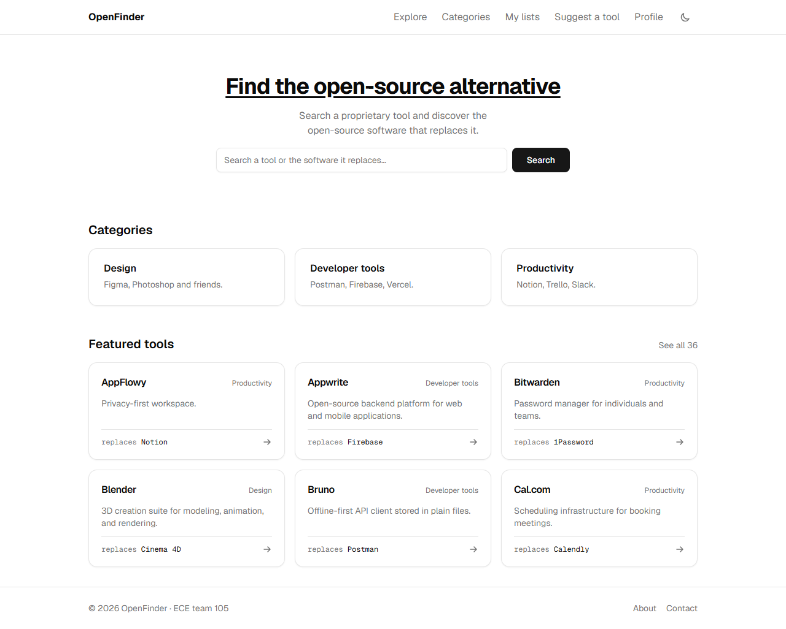

# Project Name: OpenFinder

- **Team Members:**
  - Yannis De Saint Loubert
  - Lilian Bulteau
  - Arsène Léonard Barton--von Saurma
- **Deployed URL:** [https://openfinder-ivory.vercel.app]

---

## 1. Concept & User Experience

OpenFinder is a directory of open-source alternatives to popular proprietary
software. Visitors search or browse by category, open a tool page enriched with
live GitHub data, and, once signed in, save tools to personal lists or suggest
new tools for moderators to review.

### Key Features (UI/UX)

**Home page**: search bar, category shortcuts and featured tools.

---

## 2. Full-Stack Functionality

### Authentication

- [x] Sign-up implemented
- [x] Sign-in implemented
- [x] Sign-out implemented
- [x] The UI updates based on user state

**Notes**: Supabase email/password auth via Server Actions
(`client/app/auth/actions.js`). The profile page shows the account or sign-in
links, and private pages redirect guests to sign-in.

**Self-Evaluation:**: Complete flow with validation, clear error messages and
safe redirects.

### CRUD Operations

- **Main Resource:** Personal lists of tools (`lists` and `list_items`)
- [x] Create
- [x] Read
- [x] Update
- [x] Delete

**Notes**: Server Actions in `client/app/list/actions.js` create, rename and
delete lists, and add or remove tools in them.

**Self-Evaluation:**: Full CRUD with input validation on the server and RLS as
the final check.

### Data Relationships

- **Tables Involved:** `categories` → `tools`, `auth.users` → `lists`,
  `lists` ↔ `tools` through `list_items`, `auth.users` → `tool_submissions`
- [x] Relationship implemented

**Notes**: `tools` belongs to a category; `list_items` joins lists and tools
(many-to-many).

**Self-Evaluation:**: One-to-many and many-to-many relationships, both used in
the UI (category pages, list contents).

### Search & Filtering

- [x] Search implemented
- [x] Filter implemented, available options: by category

**Notes**: `/explore` searches by tool name or replaced software, filters by
category and paginates; all parameters live in the URL.

**Self-Evaluation:**: Search, filter and pagination combined, rendered on the
server, with loading, empty and error states.

### External API Integration

- **API Used:** GitHub REST API (https://api.github.com/repos/{owner}/{repo})
- **Data fetched:** Stars, forks, license, last update date and repository link

**Notes**: Fetched server-side with a 60-second cache; if GitHub fails, the
section is hidden and the page still renders.

**Self-Evaluation:**: Robust integration: cached, validated and fault tolerant,
covered by unit tests.

---

## 3. Engineering & Architecture

### Database Schema

*Provide a screenshot of your Supabase Table Editor or a text description of your tables and relationships.*

| Table | Main columns | Relationships |
| --- | --- | --- |
| `categories` | `id`, `slug`, `name`, `description` | Has many `tools` |
| `tools` | `id`, `slug`, `name`, `alternative_to`, `description`, `github_repo`, `website_url` | `category_id` → `categories` |
| `lists` | `id`, `user_id`, `name`, `description` | `user_id` → `auth.users` |
| `list_items` | `list_id`, `tool_id` | Joins `lists` and `tools` |
| `tool_submissions` | `id`, `user_id`, `category_id`, `name`, `alternative_to`, `description`, `github_repo`, `website_url`, `status`, `moderator_note` | `user_id` → `auth.users`, `category_id` → `categories` |
| `contacts` | `id`, `name`, `email`, `message` | None |

**Notes**: The schema is versioned in `supabase/migrations/` and seeded by
`supabase/seed.sql`.

**Self-Evaluation:**: Normalized schema with constraints, versioned migrations
and reproducible seed data.

### Row Level Security (RLS)

*Provide a screenshot of the **Supabase Authentication > Policies** dashboard showing your active policies. This is mandatory.*

[INSERT RLS DASHBOARD SCREENSHOT HERE]

**Notes**: RLS is on for every table: the catalogue is public read-only, and
users can only access their own lists and suggestions. Policies are tested with
pgTAP in `supabase/tests/`.

**Self-Evaluation:**: Policies cover every table and are tested, not only
described.

### Server vs. Client Components

**Server Component:** `client/app/explore/page.js`
    - *Why?* Reads the URL parameters and queries Supabase on the server, so the
      results are in the HTML (SEO, no client fetch) and no database code ships
      to the browser.

**Client Component:** `client/components/layout/NavLinks.js`
    - *Why?* Needs `usePathname()` to highlight the active link and React state
      for the mobile menu (open/close, Escape key).

---

## 4. Self-Reflection & Feedback

*This section must be completed **individually** by each team member.*

### Proudest Achievement

*What is the technically most difficult or most polished feature you built?*

Yannis De Saint Loubert: [Your answer here]

Lilian Bulteau: The Explore page: you can search for a tool, filter by category and move between pages, and everything is saved in the URL, so a search could be shared.

Arsène Léonard Barton--von Saurma: [Your answer here]

### What Would You Improve?

*If you had more time, what would you add or improve in your project?*

Yannis De Saint Loubert: [Your answer here]

Lilian Bulteau: I would let users rate and review tools and make lists shareable with a public link.

Arsène Léonard Barton--von Saurma: [Your answer here]

### Course Feedback (Bonus)

*What did you enjoy about this course? What could be improved for next year?*

Yannis De Saint Loubert: [Your answer here]

Lilian Bulteau: I liked the MCQs during the online sessions, they kept me engaged unlike other theoretical online lecture. The course was interesting and made me curious.

Arsène Léonard Barton--von Saurma: [Your answer here]
