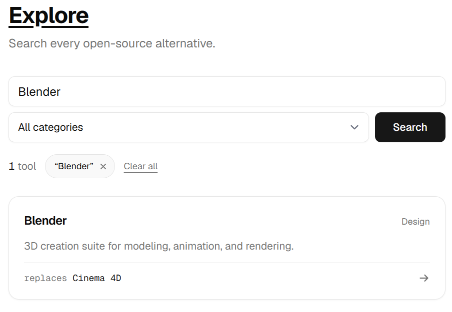

# Project Name: OpenFinder

- **Team Members:**
  - Yannis De Saint Loubert
  - Lilian Bulteau
  - Arsène Léonard Barton--von Saurma
- **Deployed URL:** https://openfinder-ivory.vercel.app

---

## 1. Concept & User Experience

### Key Features (UI/UX)

Save these screenshots in `documentation/screenshots/`.

---

## 2. Full-Stack Functionality

*Briefly describe how you implemented the core requirements. Keep it concise (1-2 sentences per item).*

### Authentication

- [x] Sign-up implemented
- [x] Sign-in implemented
- [x] Sign-out implemented
- [x] The UI updates based on user state

**Notes**: Email/password and GitHub OAuth use Supabase Auth.

**Self-Evaluation:**: Authentication works locally and in production, including logout and session state.

### CRUD Operations

- **Main Resource:** Personal lists
- [x] Create
- [x] Read
- [x] Update
- [x] Delete

**Notes**: Authenticated users create, rename, describe, and delete their lists.

**Self-Evaluation:**: CRUD is protected by Supabase RLS.

### Data Relationships

- **Tables Involved:** `lists`, `list_items`, and `tools`
- [x] Relationship implemented

**Notes**: `list_items` links one list to one tool with a composite primary key.
**Self-Evaluation:**: The relationship supports ownership and cascade deletion.

### Search & Filtering

- [x] Search implemented
- [x] Filter implemented, available options: category and search text

**Notes**: `/explore` combines database search, category filtering, and exact-count pagination.

**Self-Evaluation:**: Search and filters use Supabase and remain shareable through query parameters.

### External API Integration

- **API Used:** GitHub REST API
- **Data fetched:** Stars, forks, license, and repository link

**Notes**: The server fetch is cached and hides the GitHub section on errors.

**Self-Evaluation:**: External API failures do not prevent the tool page from rendering.

---

## 3. Engineering & Architecture

### Database Schema

Capture Supabase **Table Editor** showing `categories`, `tools`, `lists`, and `list_items`.
Save it as `documentation/screenshots/supabase-schema.png`.

**Notes**: The schema uses foreign keys, indexes, a composite key, and versioned migrations.

**Self-Evaluation:**: Public catalogue data and private collections are clearly separated.

### Row Level Security (RLS)

Capture **Authentication → Policies** for `lists` and `list_items`.
Save it as `documentation/screenshots/supabase-policies.png`.

**Notes**: Policies compare `auth.uid()` with `lists.user_id` and protect nested list items.

**Self-Evaluation:**: Anonymous users cannot read or modify private lists.

### Server vs. Client Components

*Identify one significant Server Component and one Client Component in your app.*

**Server Component:** `client/app/list/page.js`
    - Reads the authenticated session and personal lists on each request.

**Client Component:** `client/components/layout/NavLinks.js`
    - Reads the browser pathname and manages responsive navigation state.

---

## 4. Self-Reflection & Feedback

*This section must be completed **individually** by each team member.*

### Proudest Achievement

*What is the technically most difficult or most polished feature you built?*

Yannis: [À compléter individuellement]

Lilian: [À compléter individuellement]

Arsène: [À compléter individuellement]

### What Would You Improve?

*If you had more time, what would you add or improve in your project?*

Yannis: [À compléter individuellement]

Lilian: [À compléter individuellement]

Arsène: [À compléter individuellement]

### Course Feedback (Bonus)

*What did you enjoy about this course? What could be improved for next year?*

Yannis: [À compléter individuellement]

Lilian: [À compléter individuellement]

Arsène: [À compléter individuellement]
