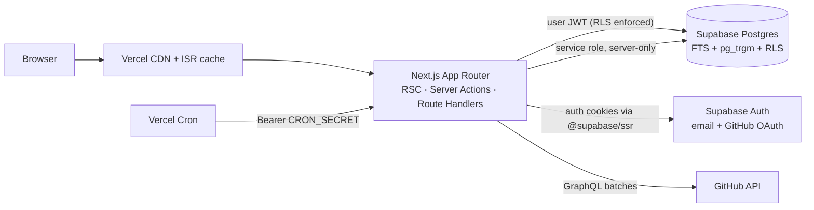

# OpenSource Finder: architecture plan

## Assumptions

- **Versions:** Next.js 16 with React 19 and Tailwind v4 (latest stable majors), as a single repo with no monorepo. `middleware.ts` is called `proxy.ts` in Next 16.
- **Auth model:** "Visitor" means unauthenticated. The `user`, `moderator` and `admin` roles live in `profiles.role` and are ordered (admin > moderator > user).
- **i18n:** UI is FR/EN via `next-intl`. Content is stored in one language per resource, and a translations table comes in V2. URL slugs are French, as in your example (`/categories/cybersecurite/outils/nmap`), and the default locale (FR) has no URL prefix.
- **Taxonomy:** two-level category tree (domain → sub-category), with one primary category per resource plus optional secondary ones.
- **Reports:** reporting a listing requires an account, to limit spam.
- **Sizing:** one developer, with 1 person-day ≈ 6 focused hours.

---

## 1. Architecture overview



Principles:

- **Reads** happen in Server Components through a server-only data layer (`lib/data`). They never call GitHub at request time, because Postgres is the cache.
- **Writes** go through Server Actions: Zod validation, then insert or RPC under the **user's JWT**, so RLS is the real authorization layer.
- **Privileged operations** are `SECURITY DEFINER` RPCs with an explicit role check (approve/reject, role changes). The service-role client is used only by the cron job.
- **Three Supabase clients:** browser (publishable key), server (cookie session), admin (`server-only`, service role).
- **Rendering:** resource and category pages use ISR with `revalidateTag` after approvals and syncs. `/search` is dynamic.

---

## 2. Project tree

```
opensource-finder/
├─ app/
│  ├─ [locale]/                    # next-intl segment
│  │  ├─ layout.tsx · page.tsx · error.tsx · not-found.tsx
│  │  ├─ (auth)/login · signup
│  │  ├─ categories/[domain]/[sub]/[slug]/page.tsx   # canonical resource page
│  │  ├─ search/ · tags/[tag]/ · collections/[username]/[slug]/ · c/[token]/
│  │  ├─ me/ (profile, favorites, collections, submissions)
│  │  ├─ contribute/ (new, edit/[slug])
│  │  ├─ moderation/ (queue, [id], reports, history)
│  │  └─ admin/ (users, taxonomy)
│  ├─ auth/callback/route.ts       # code exchange (OAuth/email)
│  ├─ api/ cron/github-sync · search/suggest · health
│  ├─ rss.xml/route.ts · sitemap.ts · robots.ts
├─ components/  ui · layout · catalog · search · forms · moderation · collections · auth
├─ lib/
│  ├─ supabase/ browser.ts · server.ts · admin.ts · database.types.ts
│  ├─ data/        # server-only queries (resources, categories, collections…)
│  ├─ actions/     # "use server" mutations
│  ├─ validation/  # Zod schemas shared by forms + actions
│  ├─ github/      # GraphQL client, batching, quota guard
│  ├─ auth/        # getSession, requireRole(), RoleGate helpers
│  ├─ seo/         # metadata builders, JSON-LD
│  └─ env.ts       # Zod-validated env (server vs public split)
├─ messages/ fr.json · en.json
├─ supabase/ config.toml · migrations/ · seed.sql · tests/ (pgTAP RLS tests)
├─ tests/ unit/ (Vitest) · e2e/ (Playwright + axe)
├─ .github/workflows/ci.yml
├─ proxy.ts                        # session refresh + locale + CSP nonce
└─ next.config.ts · eslint.config.mjs · .prettierrc · vitest.config.ts · playwright.config.ts
```

|Folder|Role|
|---|---|
|`app/`|Routing, pages, route handlers|
|`components/`|Reusable UI, with server components by default|
|`lib/data` vs `lib/actions`|Read path and write path kept separate and both server-only|
|`lib/validation`|Single Zod source of truth (client UX + server enforcement)|
|`supabase/`|Migrations, seed, RLS tests (the DB is versioned like code)|

---

## 3. Database schema (migration)

`supabase/migrations/20261009000000_init.sql`

```sql
create extension if not exists pg_trgm  with schema extensions;
create extension if not exists unaccent with schema extensions;

create type app_role          as enum ('user','moderator','admin');   -- order matters (>=)
create type resource_type     as enum ('software','tool','library','framework','documentation','course','cheatsheet','dataset','lab','other');
create type difficulty        as enum ('beginner','intermediate','advanced');
create type platform          as enum ('linux','windows','macos','android','ios','web','docker','cross_platform');
create type resource_status   as enum ('published','hidden','archived');
create type submission_kind   as enum ('create','update');
create type submission_status as enum ('pending','approved','rejected');
create type report_status     as enum ('open','resolved','dismissed');
create type visibility        as enum ('private','unlisted','public');

create function public.immutable_unaccent(text) returns text
language sql immutable parallel safe set search_path = extensions, public
as $$ select extensions.unaccent('extensions.unaccent'::regdictionary, $1) $$;

create function public.touch_updated_at() returns trigger language plpgsql as $$
begin new.updated_at = now(); return new; end $$;

-- ───────── Identity ─────────
create table public.profiles (
  id uuid primary key references auth.users(id) on delete cascade,
  username text not null unique check (username ~ '^[a-z0-9_-]{3,32}$'),
  display_name text, avatar_url text,
  role app_role not null default 'user',
  created_at timestamptz not null default now()
);

create function public.handle_new_user() returns trigger
language plpgsql security definer set search_path = public as $$
begin
  insert into public.profiles (id, username, display_name, avatar_url)
  values (new.id, 'user_' || substr(replace(new.id::text,'-',''),1,10),
          coalesce(new.raw_user_meta_data->>'user_name', new.raw_user_meta_data->>'name'),
          new.raw_user_meta_data->>'avatar_url');
  return new;
end $$;
create trigger on_auth_user_created after insert on auth.users
  for each row execute function public.handle_new_user();

create function public.has_role(min_role app_role) returns boolean
language sql stable security definer set search_path = public as $$
  select coalesce((select p.role >= min_role from public.profiles p
                   where p.id = (select auth.uid())), false)
$$;

-- ───────── Taxonomy ─────────
create table public.licenses (
  spdx_id text primary key, name text not null, osi_approved boolean not null default false
);
create table public.categories (
  id uuid primary key default gen_random_uuid(),
  parent_id uuid references public.categories(id) on delete restrict,  -- depth ≤ 2 by convention
  slug text not null, name jsonb not null,            -- {"fr":"Cybersécurité","en":"Cybersecurity"}
  description jsonb, position int not null default 0,
  unique nulls not distinct (parent_id, slug)
);
create table public.tags (
  id uuid primary key default gen_random_uuid(),
  slug text not null unique, name text not null
);

-- ───────── Catalog ─────────
create table public.resources (
  id uuid primary key default gen_random_uuid(),
  slug text not null unique check (slug ~ '^[a-z0-9]+(-[a-z0-9]+)*$'),
  name text not null check (char_length(name) between 1 and 100),
  summary text not null check (char_length(summary) between 10 and 280),
  description text,                                   -- markdown, sanitized at render
  type resource_type not null,
  difficulty difficulty,
  license_spdx text references public.licenses(spdx_id),
  platforms platform[] not null default '{}',
  website_url text check (website_url ~* '^https://'),
  repo_url    text check (repo_url ~* '^https://'),
  github_repo text check (github_repo ~ '^[\w.-]+/[\w.-]+$'),   -- 'owner/name'
  status resource_status not null default 'published',
  popularity int not null default 0,
  upstream_updated_at timestamptz,
  created_by uuid references public.profiles(id) on delete set null,
  created_at timestamptz not null default now(),
  updated_at timestamptz not null default now(),
  search tsvector,
  check (website_url is not null or repo_url is not null)
);

create function public.resources_before_write() returns trigger language plpgsql as $$
begin
  new.updated_at := now();
  new.search :=
    setweight(to_tsvector('simple', public.immutable_unaccent(new.name)), 'A') ||
    setweight(to_tsvector('simple', public.immutable_unaccent(new.summary)), 'B') ||
    setweight(to_tsvector('simple', public.immutable_unaccent(coalesce(new.description,''))), 'C');
  return new;
end $$;
create trigger resources_bw before insert or update on public.resources
  for each row execute function public.resources_before_write();

create table public.resource_categories (            -- N-N
  resource_id uuid references public.resources(id) on delete cascade,
  category_id uuid references public.categories(id) on delete cascade,
  is_primary boolean not null default false,
  primary key (resource_id, category_id)
);
create unique index one_primary_category on public.resource_categories (resource_id) where is_primary;

create table public.resource_tags (                  -- N-N
  resource_id uuid references public.resources(id) on delete cascade,
  tag_id uuid references public.tags(id) on delete cascade,
  primary key (resource_id, tag_id)
);

create table public.github_metadata (                -- written by cron only
  resource_id uuid primary key references public.resources(id) on delete cascade,
  stars int not null default 0, forks int not null default 0, open_issues int not null default 0,
  pushed_at timestamptz, is_archived boolean not null default false,
  license_spdx text, latest_release_tag text, latest_release_at timestamptz,
  fetched_at timestamptz, error_count smallint not null default 0, last_error text
);

-- ───────── Contributions & moderation ─────────
create table public.submissions (
  id uuid primary key default gen_random_uuid(),
  submitter_id uuid not null references public.profiles(id) on delete cascade,
  kind submission_kind not null,
  target_resource_id uuid references public.resources(id) on delete cascade,
  payload jsonb not null check (jsonb_typeof(payload)='object' and pg_column_size(payload) < 20000),
  status submission_status not null default 'pending',
  reviewer_id uuid references public.profiles(id),
  reviewed_at timestamptz, rejection_reason text,
  created_at timestamptz not null default now(),
  check ((kind = 'update') = (target_resource_id is not null)),
  check (status <> 'rejected' or rejection_reason is not null)
);
create function public.limit_submissions() returns trigger language plpgsql as $$
begin
  if (select count(*) from public.submissions
      where submitter_id = new.submitter_id and created_at > now() - interval '1 hour') >= 5
  then raise exception 'rate_limited'; end if;
  return new;
end $$;
create trigger submissions_rate_limit before insert on public.submissions
  for each row execute function public.limit_submissions();

create table public.moderation_actions (             -- append-only audit log
  id bigint generated always as identity primary key,
  actor_id uuid references public.profiles(id) on delete set null,
  action text not null check (action in ('approve_submission','reject_submission','hide_resource',
    'restore_resource','resolve_report','dismiss_report','set_role')),
  entity_type text not null, entity_id uuid not null,
  reason text, created_at timestamptz not null default now()
);

create table public.reports (
  id uuid primary key default gen_random_uuid(),
  resource_id uuid not null references public.resources(id) on delete cascade,
  reporter_id uuid not null references public.profiles(id) on delete cascade,
  reason text not null check (reason in ('spam','broken_link','not_open_source','outdated','inappropriate','other')),
  details text check (char_length(details) <= 1000),
  status report_status not null default 'open',
  handled_by uuid references public.profiles(id), handled_at timestamptz,
  created_at timestamptz not null default now()
);
create unique index one_open_report_per_user on public.reports (resource_id, reporter_id) where status = 'open';

-- ───────── Collections & favorites ─────────
create table public.collections (
  id uuid primary key default gen_random_uuid(),
  owner_id uuid not null references public.profiles(id) on delete cascade,
  slug text not null, title text not null check (char_length(title) between 1 and 80),
  description text check (char_length(description) <= 500),
  visibility visibility not null default 'private',
  share_token uuid not null unique default gen_random_uuid(),
  created_at timestamptz not null default now(), updated_at timestamptz not null default now(),
  unique (owner_id, slug)
);
create trigger collections_touch before update on public.collections
  for each row execute function public.touch_updated_at();
create table public.collection_items (
  collection_id uuid references public.collections(id) on delete cascade,
  resource_id uuid references public.resources(id) on delete cascade,
  position int not null default 0, note text check (char_length(note) <= 280),
  added_at timestamptz not null default now(),
  primary key (collection_id, resource_id)
);
create table public.favorites (
  user_id uuid references public.profiles(id) on delete cascade,
  resource_id uuid references public.resources(id) on delete cascade,
  created_at timestamptz not null default now(),
  primary key (user_id, resource_id)
);

-- ───────── Indexes ─────────
create index resources_search_gin   on public.resources using gin (search);
create index resources_name_trgm    on public.resources using gin (name extensions.gin_trgm_ops);
create index resources_platforms    on public.resources using gin (platforms);
create index resources_pop          on public.resources (popularity desc, id) where status = 'published';
create index resources_created      on public.resources (created_at desc)     where status = 'published';
create index resources_upstream     on public.resources (upstream_updated_at desc nulls last) where status = 'published';
create index resources_type_diff    on public.resources (type, difficulty);
create index resources_license      on public.resources (license_spdx);
create index rc_category            on public.resource_categories (category_id, resource_id);
create index rt_tag                 on public.resource_tags (tag_id, resource_id);
create index gh_stale               on public.github_metadata (fetched_at nulls first);
create index sub_queue              on public.submissions (status, created_at);
create index sub_by_user            on public.submissions (submitter_id, created_at desc);
create index reports_open           on public.reports (created_at) where status = 'open';
create index col_public             on public.collections (updated_at desc) where visibility = 'public';
create index ci_resource            on public.collection_items (resource_id);
create index fav_resource           on public.favorites (resource_id);

-- ───────── Search RPC (SECURITY INVOKER → RLS applies) ─────────
create function public.search_resources(
  q text default null, p_category_ids uuid[] default null, p_license text[] default null,
  p_platform platform default null, p_difficulty difficulty default null,
  p_type resource_type default null, p_sort text default 'popularity',
  p_limit int default 24, p_offset int default 0
) returns table (id uuid, slug text, name text, summary text, type resource_type,
  difficulty difficulty, license_spdx text, platforms platform[], popularity int, total bigint)
language sql stable set search_path = public, extensions as $$
  with s as (select nullif(trim(q), '') as term,
                    websearch_to_tsquery('simple', public.immutable_unaccent(coalesce(q,''))) as tsq)
  select r.id, r.slug, r.name, r.summary, r.type, r.difficulty, r.license_spdx,
         r.platforms, r.popularity, count(*) over () as total
  from public.resources r cross join s
  where r.status = 'published'
    and (s.term is null or r.search @@ s.tsq or r.name % s.term)     -- FTS OR trigram (typos)
    and (p_license    is null or r.license_spdx = any(p_license))
    and (p_platform   is null or p_platform = any(r.platforms))
    and (p_difficulty is null or r.difficulty = p_difficulty)
    and (p_type       is null or r.type = p_type)
    and (p_category_ids is null or exists (select 1 from public.resource_categories rc
         where rc.resource_id = r.id and rc.category_id = any(p_category_ids)))
  order by
    case when p_sort = 'relevance' and s.term is not null
         then ts_rank(r.search, s.tsq) + similarity(r.name, s.term) end desc nulls last,
    case when p_sort = 'popularity' then r.popularity end desc nulls last,
    case when p_sort = 'recent'     then r.created_at end desc nulls last,
    case when p_sort = 'updated'    then r.upstream_updated_at end desc nulls last,
    case when p_sort = 'name'       then r.name end asc nulls last,
    r.id
  limit least(p_limit, 100) offset greatest(p_offset, 0)
$$;
```

Privileged RPCs, defined in a second migration (all `SECURITY DEFINER`, role checked inside, each writing a `moderation_actions` row):

- `approve_submission(id)`: applies the payload to `resources`, tags and categories, and sets status, reviewer and timestamp.
- `reject_submission(id, reason)`
- `set_resource_status(id, status, reason)`
- `resolve_report(id, status)`
- `set_user_role(user_id, role)` (admin only)
- `get_collection_by_token(token)`: returns a `public` or `unlisted` collection with its published items.
- `refresh_popularity()`: called by the cron job.

V2 tables: `resource_translations`, `proprietary_products`, and `resource_alternatives`.

---

## 4. RLS policies

|Table|Visitor|User|Moderator|Admin|
|---|---|---|---|---|
|`profiles`|read|read; update own `username/display_name/avatar_url`|read|read; role via RPC|
|`licenses`, `categories`|read|read|read|read/write|
|`tags`|read|read|read/write|read/write|
|`resources`|read published|read published|read all, insert/update|+ delete|
|`resource_categories`, `resource_tags`|read (published parents)|same|write|write|
|`github_metadata`|read (published parents)|same|same|same (writes = service role only)|
|`submissions`|none|insert own (pending), read own, delete own pending|read all (decisions via RPC)|same|
|`moderation_actions`|none|none|read|read (writes via RPC only)|
|`reports`|none|insert, read own|read, update|same|
|`collections`|read `public`|CRUD own + read `public`|same|same|
|`collection_items`|read if parent visible|write if owner|same|same|
|`favorites`|none|CRUD own|own|own|

Key policies. Always use `(select auth.uid())` so the planner caches it per query:

```sql
do $$ declare t text; begin
  for t in select tablename from pg_tables where schemaname = 'public' loop
    execute format('alter table public.%I enable row level security', t);
  end loop; end $$;

-- reference data (same pattern for categories; tags use 'moderator')
create policy lic_read  on public.licenses for select using (true);
create policy lic_write on public.licenses for all to authenticated
  using (public.has_role('admin')) with check (public.has_role('admin'));

-- profiles: role can never be self-edited (column-level grant)
create policy prof_read on public.profiles for select using (true);
create policy prof_upd  on public.profiles for update to authenticated
  using (id = (select auth.uid())) with check (id = (select auth.uid()));
revoke update on public.profiles from authenticated;
grant  update (username, display_name, avatar_url) on public.profiles to authenticated;

-- resources
create policy res_read on public.resources for select
  using (status = 'published' or public.has_role('moderator'));
create policy res_ins  on public.resources for insert to authenticated with check (public.has_role('moderator'));
create policy res_upd  on public.resources for update to authenticated
  using (public.has_role('moderator')) with check (public.has_role('moderator'));
create policy res_del  on public.resources for delete to authenticated using (public.has_role('admin'));

-- child tables inherit visibility through the parent's RLS
create policy rc_read on public.resource_categories for select
  using (exists (select 1 from public.resources r where r.id = resource_id));
create policy rc_write on public.resource_categories for all to authenticated
  using (public.has_role('moderator')) with check (public.has_role('moderator'));
-- same for resource_tags and github_metadata (read only; no write policy = service role only)

-- submissions: no UPDATE policy, decisions go through RPC
create policy sub_read on public.submissions for select to authenticated
  using (submitter_id = (select auth.uid()) or public.has_role('moderator'));
create policy sub_ins  on public.submissions for insert to authenticated
  with check (submitter_id = (select auth.uid()) and status = 'pending' and reviewer_id is null);
create policy sub_del  on public.submissions for delete to authenticated
  using (submitter_id = (select auth.uid()) and status = 'pending');

-- audit log: readable by moderators, writable only by RPC
create policy ma_read on public.moderation_actions for select to authenticated
  using (public.has_role('moderator'));

-- reports
create policy rep_ins  on public.reports for insert to authenticated
  with check (reporter_id = (select auth.uid()) and status = 'open');
create policy rep_read on public.reports for select to authenticated
  using (reporter_id = (select auth.uid()) or public.has_role('moderator'));
create policy rep_upd  on public.reports for update to authenticated
  using (public.has_role('moderator')) with check (public.has_role('moderator'));

-- collections (unlisted ones are reachable ONLY through get_collection_by_token)
create policy col_read on public.collections for select
  using (visibility = 'public' or owner_id = (select auth.uid()));
create policy col_ins  on public.collections for insert to authenticated
  with check (owner_id = (select auth.uid()));
create policy col_upd  on public.collections for update to authenticated
  using (owner_id = (select auth.uid())) with check (owner_id = (select auth.uid()));
create policy col_del  on public.collections for delete to authenticated
  using (owner_id = (select auth.uid()));

create policy ci_read  on public.collection_items for select
  using (exists (select 1 from public.collections c where c.id = collection_id));
create policy ci_write on public.collection_items for all to authenticated
  using (exists (select 1 from public.collections c where c.id = collection_id and c.owner_id = (select auth.uid())))
  with check (exists (select 1 from public.collections c where c.id = collection_id and c.owner_id = (select auth.uid())));

create policy fav_all on public.favorites for all to authenticated
  using (user_id = (select auth.uid())) with check (user_id = (select auth.uid()));
```

The `role` column is readable by everyone. This is acceptable because emails live in `auth.users`, which is not exposed. Test every policy per role with pgTAP (`supabase test db`) in CI.

---

## 5. Routes

**Pages**

|Route|Purpose|Access|Rendering|
|---|---|---|---|
|`/`|Featured, new, popular per domain|Public|ISR|
|`/search`|Search (`?q&cat&license&os&level&type&sort&page`)|Public|Dynamic|
|`/categories`, `/categories/[domain]`, `/categories/[domain]/[sub]`|Browsing|Public|ISR|
|`/categories/[domain]/[sub]/[slug]`|Resource page|Public|ISR + tag revalidation; 308 to canonical if segments don't match|
|`/tags/[tag]`|Resources by tag|Public|ISR|
|`/collections`, `/collections/[username]/[slug]`|Public collections|Public (private → owner)|Dynamic|
|`/c/[token]`|Shared unlisted collection|Anyone with the link|Dynamic|
|`/login`, `/signup`|Auth|Anonymous|Static|
|`/me`, `/me/favorites`, `/me/collections`, `/me/submissions`|Personal area|User+|Dynamic|
|`/contribute/new`, `/contribute/edit/[slug]`|Propose a resource or an edit|User+|Dynamic|
|`/moderation`, `/moderation/[id]`, `/moderation/reports`, `/moderation/history`|Queue, review, reports, audit|Moderator+|Dynamic|
|`/admin/users`, `/admin/taxonomy`|Roles, categories, tags, licenses|Admin|Dynamic|
|`/sitemap.xml`, `/robots.txt`, `/rss.xml`|SEO / feed|Public|Cached|

**Route handlers**

- `GET /api/search/suggest?q=` is public, rate-limited and cached for 60 s.
- `GET /api/cron/github-sync` requires `Authorization: Bearer CRON_SECRET`.
- `GET /api/health` is public, and its Supabase ping keeps a free-tier project from pausing.
- `GET /auth/callback` handles the code exchange.

**Server Actions**

|Action|Access|
|---|---|
|`signUp`, `signIn`, `signInWithGitHub`, `signOut`|Public|
|`updateProfile`|User|
|`submitResource`, `submitEdit`, `withdrawSubmission`|User (rate-limited)|
|`reportResource`|User|
|`createCollection`, `updateCollection`, `deleteCollection`, `toggleCollectionItem`, `toggleFavorite`|User (owner)|
|`approveSubmission`, `rejectSubmission`, `resolveReport`, `setResourceStatus`|Moderator+|
|`setUserRole`, `manageTaxonomy`|Admin|

Every action follows the same order: authenticate, Zod-parse, call the DB under the user's JWT, `revalidateTag`.

---

## 6. UI components

Legend: **(c)** = client component. Everything else is a Server Component.

- **ui** (accessible primitives, Radix/shadcn-style): Button, Input, Select, Checkbox, Dialog(c), DropdownMenu(c), Tabs, Badge, Toast(c), Skeleton, Tooltip(c), VisuallyHidden
- **layout:** Header, Footer, Container, Breadcrumbs, ThemeToggle(c), LocaleSwitcher(c), SkipLink, UserMenu(c)
- **catalog:** ResourceCard, ResourceGrid, ResourceHeader, ResourceMeta, LicenseBadge, PlatformIcons, DifficultyBadge, TypeBadge, TagList, GithubStats, CategoryTree, AlternativesList (V2)
- **search:** SearchBar(c), SuggestList(c), FilterPanel(c, state in URL), FilterChip, ActiveFilters, SortSelect(c), Pagination, EmptyState
- **forms:** ResourceForm(c, react-hook-form + Zod), FormField, TagInput(c), MultiSelect(c), SubmissionDiff (for edit proposals)
- **moderation:** QueueTable, SubmissionReview, DecisionDialog(c), AuditLogTable, ReportCard
- **collections:** CollectionCard, AddToCollectionMenu(c), FavoriteButton(c, optimistic), ShareLinkButton(c), VisibilitySelect
- **auth:** AuthForm(c), OAuthButton, RoleGate (server-side guard, never trust the client)

---

## 7. GitHub integration

- **Scope:** only resources with `github_repo`.
- **Fetched fields:** stars, forks, open issues, `pushedAt`, archived, SPDX license, latest release.
- **API:** GraphQL, with about 50 aliased `repository(owner,name)` fields per request, so 1,000 repos is about 20 calls. The token is a fine-grained read-only PAT in `GITHUB_TOKEN`, server-side only. Move to a GitHub App if the quota becomes tight.
- **Schedule:** Vercel Cron calls `/api/cron/github-sync`, which picks the N stalest rows (`order by fetched_at nulls first`, N≈200, within `maxDuration`). Popular repos are refreshed about daily and the rest weekly. Vercel Hobby limits crons to once per day, so move to Pro or a GitHub Actions schedule if you need a faster cadence. New or approved resources are synced immediately.
- **Cache:** `github_metadata` is the cache. Pages never call GitHub. After a batch, the job calls `revalidateTag('resource:<slug>')` and then `refresh_popularity()`, which blends stars (log scale), recent activity and favorites.
- **Quota handling:**
    - Read `rateLimit { remaining resetAt }` on every response and stop the run below ~10% remaining.
    - Honor `retry-after` on secondary limits, with exponential backoff.
    - Skip rows whose `error_count` has reached 3, and flag them for moderation (repo deleted or renamed). Update `github_repo` on a rename redirect.
- **Conflicts:** a license mismatch against `resources.license_spdx` creates a moderation flag. It never overwrites the record.
- **Properties:** the job is idempotent and resumable, and it logs a summary (updated, failed, remaining quota).

---

## 8. Initial configuration

`package.json` (dependency versions are filled in by the install commands below):

```json
{
  "name": "opensource-finder",
  "private": true,
  "volta": { "node": "26.0.0" },
  "engines": { "node": ">=26" },
  "scripts": {
    "dev": "next dev",
    "build": "next build",
    "start": "next start",
    "lint": "eslint .",
    "typecheck": "tsc --noEmit",
    "format": "prettier --write .",
    "test": "vitest run",
    "test:e2e": "playwright test",
    "db:types": "supabase gen types typescript --local > lib/supabase/database.types.ts"
  }
}
```

`volta pin node@26` writes the exact current 26.x version, so use its output instead of `26.0.0`. In `tsconfig.json`, keep `"strict": true` and add `"noUncheckedIndexedAccess": true`.

`.env.example`:

```bash
NEXT_PUBLIC_SITE_URL=http://localhost:3000
NEXT_PUBLIC_SUPABASE_URL=http://127.0.0.1:54321
NEXT_PUBLIC_SUPABASE_ANON_KEY=            # publishable key, safe for the browser
SUPABASE_SERVICE_ROLE_KEY=                # SERVER ONLY, never NEXT_PUBLIC_
GITHUB_TOKEN=                             # fine-grained PAT, public read-only
CRON_SECRET=                              # long random string
SUPABASE_AUTH_GITHUB_CLIENT_ID=           # local OAuth (config.toml); set in dashboard for prod
SUPABASE_AUTH_GITHUB_SECRET=
# V1 (optional): UPSTASH_REDIS_REST_URL=, UPSTASH_REDIS_REST_TOKEN=, TURNSTILE_SECRET_KEY=
```

Install:

```bash
volta install node@26
npx create-next-app@latest opensource-finder --ts --tailwind --eslint --app --no-src-dir --import-alias "@/*" --use-npm
cd opensource-finder && volta pin node@26
npm i @supabase/supabase-js @supabase/ssr zod next-intl server-only react-hook-form @hookform/resolvers react-markdown rehype-sanitize
npm i -D prettier prettier-plugin-tailwindcss eslint-config-prettier vitest @vitejs/plugin-react jsdom @testing-library/react @playwright/test @axe-core/playwright supabase husky lint-staged
npx playwright install --with-deps
npx supabase init && npx supabase start    # then paste the migration, `npm run db:types`
```

**Security baseline**

- `proxy.ts` sets a nonce-based CSP, HSTS and `X-Content-Type-Options`.
- Server Actions get same-origin checks from Next.js, which covers CSRF.
- Route Handlers are read-only or secret-protected.
- Markdown goes through `rehype-sanitize`, with no `dangerouslySetInnerHTML` on user content, and URLs must be https.
- `lib/env.ts` validates env at boot, and `admin.ts` imports `server-only`.

**CI** (`ci.yml`): lint, typecheck, Vitest, `supabase start` with pgTAP RLS tests, build, then Playwright with axe on key pages.

---

## 9. Roadmap

|Phase|Tasks (in order)|Effort|
|---|---|---|
|**MVP** (~22 d)|1. Repo, tooling, CI (1.5) · 2. Schema, seed, types, RLS + pgTAP (3) · 3. Layout, dark mode, a11y base (2) · 4. Category and resource pages, metadata, sitemap (3) · 5. Search, filters, pagination (3) · 6. Email + GitHub auth, profiles, role guards (2) · 7. Contribution form, Zod, submissions, rate limit (2.5) · 8. Moderation queue, approve/reject, audit log (3) · 9. Smoke tests, Vercel + Supabase deploy (2)|≈ 22 d|
|**V1** (~20 d)|Collections, favorites, share links (3) · GitHub sync (3.5) · Reports (1.5) · Edit proposals with diff (2) · Moderation history/dashboard (1.5) · IP rate limit + Turnstile (1.5) · SEO hardening, JSON-LD (1.5) · Perf pass (`EXPLAIN`, ISR tuning) (1.5) · WCAG AA audit and fixes (2) · E2E coverage (2)|≈ 20 d|
|**V2** (~16 d)|FR/EN content translations (4) · Alternatives ("open equivalent of X") (3) · RSS (1) · Email notifications on decisions (2) · Bulk seed/import tooling from curated lists (3) · Link checker (1.5) · Admin analytics (2)|≈ 16 d|

Total is about 58 person-days. At roughly 12 h/week of availability, that is about 30 weeks. At about 25 h/week it is about 14 weeks.

---

## 10. Risks and architecture choices

|Risk|Mitigation|
|---|---|
|**Node 26 on Vercel.** Vercel Sandbox already supports Node.js 26, but I couldn't confirm it for builds and Functions.|Check Project Settings → Node.js version before the first deploy. Fallback is Node 24 on Vercel while Volta keeps 26 locally (relax `engines`).|
|**RLS pitfalls** (recursion, slow policies).|`SECURITY DEFINER` helpers, `(select auth.uid())`, indexes on policy columns, pgTAP tests.|
|**Spam and abuse.**|Auth required, DB rate-limit trigger, moderation queue, Turnstile and IP limits in V1.|
|**Weak typo tolerance.** Trigram matching covers names only.|Tags and aliases help. Move to Typesense or Meilisearch if the catalog or UX outgrows Postgres.|
|**Data quality and legal.** Copied descriptions, logos and trademarks.|Write original summaries, skip logos, show license fields from SPDX.|
|**Empty catalog at launch.**|Seed 150–300 curated entries before V1, and document imported sources.|
|**Free-tier limits** (Supabase pauses after inactivity).|The daily cron and `/api/health` ping keep it active. Plan an upgrade before public launch.|
|**Slug and URL changes** hurting SEO.|Lookup is by `slug` only. Wrong category segments get a 308 to the canonical URL. Add a `slug_history` table in V1.|
|**Solo moderation load.**|Auto-checks (link validity, license match) and trusted-contributor auto-approval later.|

**Choices and rejected alternatives**

|Decision|Chosen|Rejected (why)|
|---|---|---|
|Backend|Next.js monolith + Supabase|Separate NestJS/Express API (extra infra for no gain at this scale)|
|Authorization|RLS-first, user JWT everywhere|App-level authz with Prisma/Drizzle (connects as a privileged role and bypasses RLS)|
|Data access|`supabase-js` + generated types|ORM (loses RLS context)|
|Search|Postgres FTS (`simple` + unaccent) + `pg_trgm`|Algolia/Meilisearch/Typesense (cost and ops; revisit later). `simple` avoids per-language stemming on mixed FR/EN content|
|Roles|Ordered enum on `profiles` + `has_role()`|JWT custom claims (more moving parts, though a good later optimization)|
|Submissions|`jsonb` payload + Zod, re-validated on approval|Staging tables mirroring `resources` (heavier to maintain)|
|Platforms|Enum array + GIN|Join table (overkill for ~8 stable values)|
|GitHub sync|GraphQL batching + DB cache + Vercel Cron|Per-repo REST calls (quota burn), live fetch at request time (slow, fragile), `pg_cron` + Edge Functions (more infra)|
|Pagination|Offset (≤100 per page)|Keyset (better at scale, add if deep pages get slow)|
