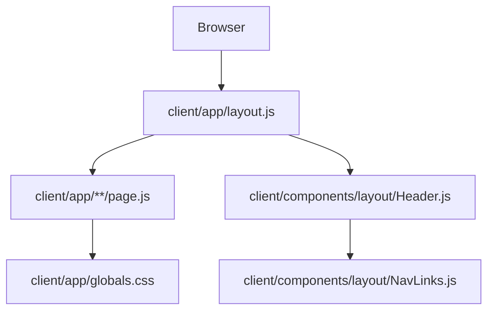

# Architecture

## Scope

OpenFinder is currently a small Next.js App Router prototype. The codebase is
intentionally simple: pages render placeholder content, the root layout owns the
site chrome, and the navigation is the only client-side component.

The target product is a searchable directory of open-source alternatives. Future
features must be introduced incrementally; the current repository does not yet
contain a database, authentication, API integration, or domain model.

## Runtime shape



All current pages are rendered by Next.js. The browser only needs JavaScript for
the active-link navigation component.

## Repository structure

```text
client/app/
  layout.js                 # HTML shell, metadata, header, main container
  page.js                   # Home page
  not-found.js              # Global 404 page
  about/page.js             # Static project page
  explore/page.js           # Dynamic exploration placeholder
  category/page.js          # Static category index
  category/[slug]/page.js   # Generated category detail
  tool/[slug]/page.js       # Incrementally regenerated tool detail
  list/page.js              # Dynamic personal-list placeholder
  profile/page.js           # Dynamic profile placeholder
  globals.css               # Global Tailwind import
client/components/
  layout/Header.js          # Sticky header and brand link
  layout/NavLinks.js        # Active route navigation (Client Component)
client/public/
  profile.png               # Static public asset
```

## Request and rendering flow

1. Next.js enters `client/app/layout.js`.
2. The layout loads global CSS, sets metadata, renders `Header`, and places the
   route content inside the shared `<main>` container.
3. The selected page renders its content.
4. A route with a `revalidate` export is cached according to its interval.
5. A route with `dynamic = 'force-dynamic'` renders for each request.
6. `NavLinks` reads the pathname in the browser and sets `aria-current="page"`.

The complete route decision table is in [RENDERING.md](RENDERING.md).

## Component boundaries

### Server Components by default

Pages and `Header` are Server Components. Keep data fetching and non-interactive
markup on the server. This reduces browser JavaScript and keeps future secrets
out of client bundles.

### Client Components only for interaction

`client/components/layout/NavLinks.js` is a Client Component because `usePathname()` requires browser
execution. New client components should have a similarly concrete reason, such as
local form state, a browser API, or event handlers.

### Styling

Tailwind v4 is imported once from `client/app/globals.css`. Prefer utility classes
already used by the project. Extract a reusable component when a visual pattern
appears in more than one route, rather than copying a long class list.

## Planned boundaries

When product features are added, keep these concerns separate:

| Concern | Planned location | Rule |
| --- | --- | --- |
| Routes and page composition | `client/app/` | Keep route-specific orchestration here |
| Reusable UI | `client/components/` | Default to Server Components |
| Data access | `client/lib/` | Keep database and external API calls out of presentational components |
| Database schema and policies | `supabase/` | Version migrations and test RLS with the schema |
| Automated tests | `tests/` | Group unit, integration, and end-to-end tests by purpose |

Do not create these folders until the corresponding feature exists.

## Error and security principles

- Add loading, empty, not-found, and error states as soon as a route gains
  asynchronous data.
- Validate user input at the boundary and authorize every write on the server.
- Keep private keys server-only; never prefix them with `NEXT_PUBLIC_`.
- Use database RLS as the final authorization boundary, not as a replacement for
  readable application checks.
- Never render untrusted Markdown or HTML without sanitization.

## Architecture change checklist

- Is the behavior implemented, or only planned?
- Does the route rendering mode still match [RENDERING.md](RENDERING.md)?
- Is the new boundary used by more than one caller?
- Are error, authorization, and empty states covered?
- Are README and architecture links still correct?
