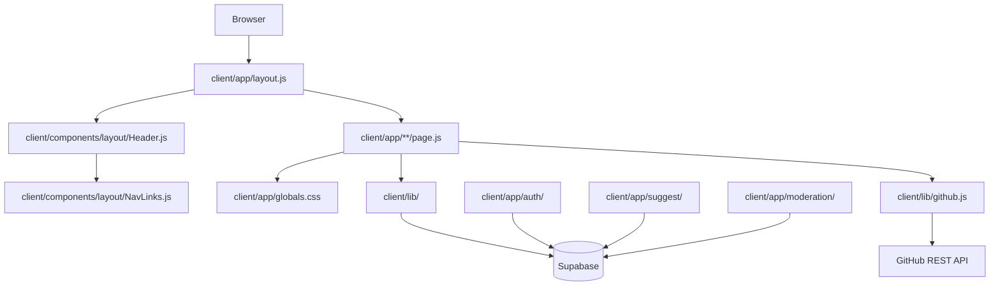

# Architecture

## Scope

OpenFinder is a Next.js App Router application for discovering open-source
alternatives. Pages own route composition, data access is centralized in
`client/lib/`, the root layout owns the site chrome, and interactive controls use
small Client Components. The schema is versioned in `supabase/migrations/` and
populated by `supabase/seed.sql`.

The application supports a public searchable catalogue, a public contact form,
Supabase email authentication, private user lists, tool suggestions, and
moderator review.

## Runtime shape



Pages render on the server by default. Client Components are limited to
interactive browser behavior such as active navigation, the theme toggle, and
form pending or validation states.

## Repository structure

```text
client/app/
  layout.js                 # HTML shell, metadata, header, footer, main container
  page.js                   # Home page (search, categories, featured tools)
  loading.js                # Shared loading skeleton
  error.js                  # Shared error boundary with retry
  not-found.js              # Global 404 page
  about/page.js             # Static project page
  explore/                  # Search, filter and pagination (own loading/error)
  category/page.js          # Category index with cached data
  category/[slug]/page.js   # Category detail with cached data
  tool/[slug]/page.js       # Session-aware tool detail with cached public data
  contact/page.js           # Public contact form
  list/page.js              # Authenticated personal-list management
  profile/page.js           # Account state and sign-out
  auth/                     # Email authentication and confirmation callback
  suggest/                  # Authenticated catalogue submissions
  moderation/               # Moderator-only submission queue
  globals.css               # Global Tailwind import
client/components/
  layout/Header.js          # Sticky header and brand link
  layout/NavLinks.js        # Active route navigation (Client Component)
  layout/ThemeToggle.js     # Light/dark switch (Client Component)
  layout/Footer.js          # Site footer with contact link
  SearchBar.js              # Search and category filter (Client Component)
  SubmitButton.js           # Pending state for server actions (Client Component)
  ContactForm.js            # Validated contact form (Client Component)
  SuggestToolForm.js        # Validated suggestion form (Client Component)
  ToolCard.js, CategoryCard.js, EmptyState.js, PageHeader.js, Pagination.js
  ui/                       # shadcn-style primitives (button, card, input...)
  lists/                    # List controls (server action forms)
  auth/                     # Shared authentication messages
client/lib/
  supabase.js               # Public catalogue queries (unstable_cache)
  supabase/                 # SSR clients and user access
  auth.js                   # Authentication validation and messages
  explore.js                # Explore URL parameter parsing
  lists.js                  # List validation and queries
  moderation.js             # Suggestion validation and queries
  github.js                 # Server-side GitHub repository lookup
  metadata.js               # Shared page metadata helper
client/proxy.js             # Supabase session refresh on matched routes
client/tests/               # Unit tests and Playwright e2e specs
client/public/              # Static public assets
supabase/
  migrations/               # Versioned PostgreSQL schema and RLS
  tests/                    # pgTAP authorization tests
  seed.sql                   # Local demonstration data
```

## Request and rendering flow

1. Next.js enters `client/app/layout.js`.
2. The layout loads global CSS, sets metadata, renders `Header` and `Footer`,
   and places the route content inside the shared `<main>` container.
3. The selected page renders its content; `loading.js` shows a skeleton while
   it streams and `error.js` catches failures.
4. A route with `dynamic = 'force-static'` is built once.
5. A route with `dynamic = 'force-dynamic'`, or that reads cookies, renders for
   each request; public catalogue queries inside it are cached by
   `unstable_cache`.
6. `NavLinks` reads the pathname in the browser and sets `aria-current="page"`.
7. `proxy.js` refreshes Supabase sessions on `/profile`, `/list`, `/auth`, and
   `/tool/[slug]`.

The complete route decision table is in [RENDERING.md](RENDERING.md).

## Component boundaries

### Server Components by default

Pages and `Header` are Server Components. Keep data fetching and non-interactive
markup on the server. This reduces browser JavaScript and keeps future secrets
out of client bundles.

### Client Components only for interaction

`client/components/layout/NavLinks.js` is a Client Component because `usePathname()` requires browser
execution. The full list of Client Components and their reasons is in
[RENDERING.md](RENDERING.md). New client components should have a similarly
concrete reason, such as local form state, a browser API, or event handlers.

### Styling

Tailwind v4 is imported once from `client/app/globals.css`. Prefer utility classes
already used by the project. Extract a reusable component when a visual pattern
appears in more than one route, rather than copying a long class list.

## Planned boundaries

When product features are added, keep these concerns separate:

| Concern | Planned location | Rule |
| --- | --- | --- |
| Routes and page composition | `client/app/` | Keep route-specific orchestration here |
| Reusable UI | `client/components/` | Default to Server Components |
| Data access | `client/lib/` | Keep database and external API calls out of presentational components |
| Database schema and policies | `supabase/` | Version migrations and test RLS with the schema |
| Automated tests | `client/tests/`, `supabase/tests/` | Keep unit, browser, and RLS tests near their runner |

### Data model

The directory data is split into two public tables:

- `categories` stores the category slug, display name, and description.
- `tools` stores each alternative and references its category through
  `category_id`. It also stores optional `github_repo` and `website_url` values.

Both catalogue tables are readable by anonymous and authenticated users. Writes
are not exposed through their policies.

Contacts can be inserted by anonymous or authenticated visitors. RLS exposes no
read policy, so messages cannot be queried through the public API.

Personal lists are available to authenticated users:

- `lists` belongs to one `auth.users` record;
- `list_items` links a list to a tool with a composite primary key;
- RLS allows authenticated users to access only their own lists and list items.

Tool suggestions are stored separately from the public catalogue:

- `tool_submissions` stores the proposed details and a pending/approved/rejected
  status;
- submitters can read only their own suggestions;
- moderators can read and review all suggestions;
- `public.is_moderator()` reads only the trusted Supabase `app_metadata` claim.

Approving a suggestion records the decision but does not publish a catalogue
tool automatically. A moderator must validate and add approved tools through a
separate trusted catalogue-maintenance process.

Public tool pages can enrich Supabase data with GitHub repository metadata.
The API call is server-side, cached for 60 seconds, and optional: failures do
not prevent the Supabase-backed tool page from rendering.

Do not create these folders until the corresponding feature exists.

## Error and security principles

- Add loading, empty, not-found, and error states as soon as a route gains
  asynchronous data.
- Validate user input at the boundary and authorize every write on the server.
- Keep private keys server-only; never prefix them with `NEXT_PUBLIC_`.
- Assign moderator claims only through a trusted Supabase admin operation; never
  trust user-editable metadata for authorization.
- Use database RLS as the final authorization boundary, not as a replacement for
  readable application checks.
- Never render untrusted Markdown or HTML without sanitization.

## Architecture change checklist

- Is the behavior implemented, or only planned?
- Does the route rendering mode still match [RENDERING.md](RENDERING.md)?
- Is the new boundary used by more than one caller?
- Are error, authorization, and empty states covered?
- Are README and architecture links still correct?
